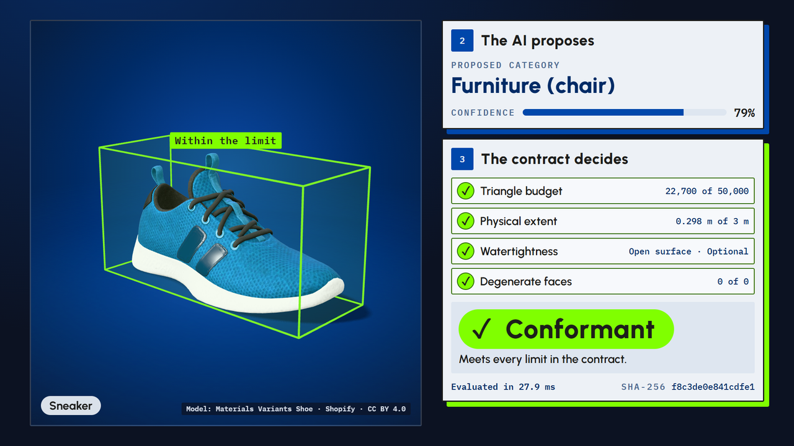
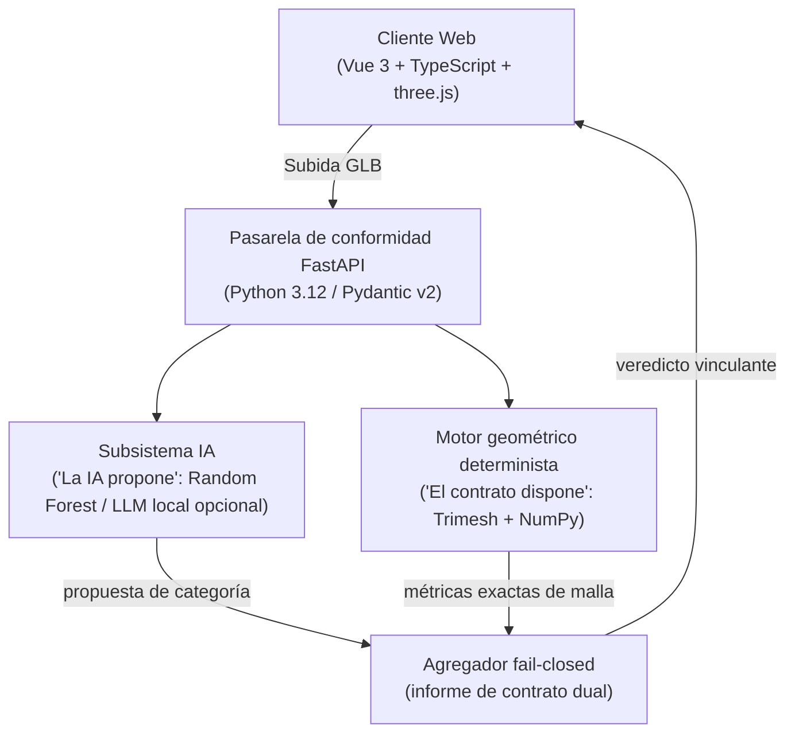

<picture>
  <source media="(prefers-color-scheme: dark)" srcset="docs/assets/banner-dark.svg">
  <source media="(prefers-color-scheme: light)" srcset="docs/assets/banner-light.svg">
  
</picture>

# Nain3D Gateway

**Un contrato de conformidad determinista para activos 3D, con un clasificador de IA que propone y nunca decide.**
Un caso de estudio de arquitectura por [NainDev](https://www.naindev.com): backend FastAPI, cliente Vue 3, registros de decisiones arquitectónicas, pruebas y comprobaciones de accesibilidad, todo en abierto.

[](README.md)
[](README.es.md)
[](https://3d.naindev.com/)
[](https://github.com/Nain9Dev/Nain3D/actions/workflows/ci.yml)
[](https://www.python.org/)
[](https://fastapi.tiangolo.com/)
[](https://docs.pydantic.dev/)
[](https://vuejs.org/)
[](https://www.typescriptlang.org/)
[](tests/test_architecture.py)
[](LICENSE)



> **"La IA propone, el contrato dispone."**  
> *(The AI proposes, the contract decides.)*

La capa de IA predice una categoría y un nivel de confianza. El motor determinista evalúa a continuación el modelo frente a límites estrictos: presupuesto de triángulos, extensión física, hermeticidad y caras degeneradas. Una comprobación bloqueante fallida rechaza el activo, sin importar lo que estime la IA. El sistema es fail-closed.

## Compruébalo en 60 segundos

| Quiero… | Dónde |
|:---|:---|
| Probarlo | [3d.naindev.com](https://3d.naindev.com) (Español por defecto, Inglés con `?lang=en`). Pulsa **C** para comparar un modelo conforme con uno no conforme |
| Ver la historia en 20 s | `https://3d.naindev.com/?mode=record` (diseño fijo 9:16 o 16:9, consulta [el guión de grabación](docs/demo-recording-script.md)) |
| Consultar la API | `http://localhost:8104/docs` tras iniciar el backend |
| Conocer el estado actual | [Estado del proyecto](docs/project-status.md): qué existe, qué está pausado, cómo reanudar |
| Entender el diseño | El [caso de estudio](docs/case-study.md): problema, regla, arquitectura, decisiones, límites |
| Revisar la ingeniería | [Especificaciones](specs/), [registros de decisiones](docs/03-decisions/), [arquitectura](docs/01-architecture.md), [métricas](docs/visual-redesign-metrics.md) |
| Ejecutar las pruebas | Comandos descritos a continuación |

## Arquitectura



## Ejecución Local

### Backend (Python 3.12 / FastAPI en puerto 8104)

```powershell
.\.venv\Scripts\uvicorn src.nain3d.main:app --port 8104 --reload
```

### Frontend (Vue 3 / Vite en puerto 5376)

```powershell
cd Nain3D.Client
npm install
npm run dev
```

### Pruebas Automatizadas

```powershell
.\.venv\Scripts\pytest tests/ -v
npm --prefix Nain3D.Client run build
npm --prefix Nain3D.Client run test
```

## Autor

**Aitor Nain Mendoza Vallejo (`NainDev`)**  
Arquitecto Full Stack & Ingeniero de Software 3D  
[naindev.com](https://www.naindev.com) · contact@naindev.com
