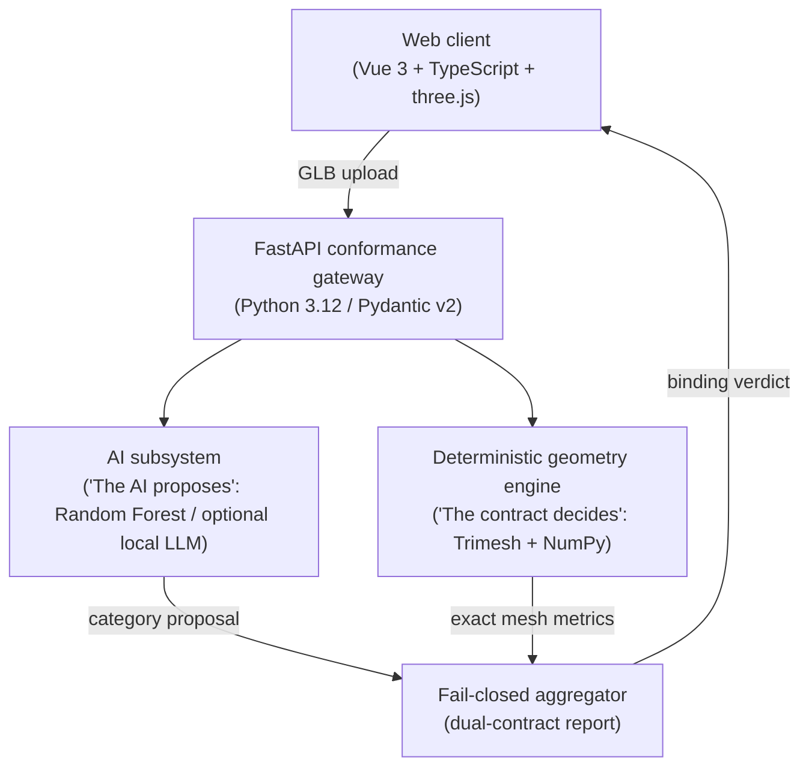

<picture>
  <source media="(prefers-color-scheme: dark)" srcset="docs/assets/banner-dark.svg">
  <source media="(prefers-color-scheme: light)" srcset="docs/assets/banner-light.svg">
  
</picture>

# Nain3D Gateway

**A deterministic conformance contract for 3D assets, with an AI classifier that proposes and never decides.**
An architecture case study by [NainDev](https://www.naindev.com): FastAPI backend, Vue 3 client, architecture
decision records, tests and accessibility checks, all in the open.

[](https://3d.naindev.com/)
[](https://github.com/Nain9Dev/Nain3D/actions/workflows/ci.yml)
[](https://www.python.org/)
[](https://fastapi.tiangolo.com/)
[](https://docs.pydantic.dev/)
[](https://vuejs.org/)
[](https://www.typescriptlang.org/)
[](tests/test_architecture.py)
[](LICENSE)


> **"The AI proposes, the contract decides."**
> *(La IA propone, el contrato dispone.)*

The AI layer predicts a category and a confidence. The deterministic engine then evaluates the model against
strict limits: triangle budget, physical extent, watertightness and degenerate faces. A failing blocking check
rejects the asset, whatever the AI believes. The system is fail-closed.

## See it in 60 seconds

| I want to… | Where |
|:---|:---|
| Try it | [3d.naindev.com](https://3d.naindev.com) (Spanish by default, English with `?lang=en`). Press **C** to compare a conformant and a non-conformant model |
| Watch the 20 s story | `https://3d.naindev.com/?mode=record` (fixed 9:16 or 16:9 layout, see [the recording script](docs/demo-recording-script.md)) |
| Read the API | `http://localhost:8104/docs` after starting the backend |
| Know the current state | [Project status](docs/project-status.md): what exists, what is paused, how to resume |
| Understand the design | The [case study](docs/case-study.md): problem, rule, architecture, decisions, limits |
| Check the engineering | [Specs](specs/), [decision records](docs/03-decisions/), [architecture](docs/01-architecture.md), [metrics](docs/visual-redesign-metrics.md) |
| Run the tests | commands below |

## Architecture



The client only presents: every figure on screen comes from the API payload, and pass/fail is the API's own
check result. See [docs/01-architecture.md](docs/01-architecture.md) for the layering and invariants.

### Decisions and trade-offs

| Area | Decision | Rejected alternative | Reason |
|:---|:---|:---|:---|
| Governance | Strict fail-closed gate: the AI never overrides the contract | Weighted voting or purely probabilistic classification | A model with a wrong scale breaks a production chain even when the AI is 99 % sure |
| Geometry engine | Trimesh + NumPy in process | Headless Blender or an external CLI | Sub-100 ms evaluation against several seconds of cold start |
| Input integrity | Binary header validation before any parsing | Trusting the extension or the browser parser | Protects against corrupt buffers and parser crashes |
| Renderer | Lazily loaded three.js stage ([ADR-002](docs/03-decisions/ADR-002-threejs-renderer.md)) | `<model-viewer>` | Overlays drawn from API data and a deterministic clock for recordings |
| Sample models | Generated by code plus one CC BY model ([ADR-003](docs/03-decisions/ADR-003-sample-generation.md), [ADR-007](docs/03-decisions/ADR-007-third-party-hero-model.md)) | Large third-party packs | Zero cost, reproducible, small |

## Conformance profiles

| Profile | Category | Triangle budget | Max dimension | Watertight required |
|:---|:---|:---:|:---:|:---:|
| `monitor-std-01` | Monitor | 25,000 | 2.5 m | No |
| `furniture-chair-01` | Furniture (chair) | 50,000 | 3.0 m | No |
| `industrial-part-01` | Industrial part | 100,000 | 1.2 m | **Yes (blocking)** |
| `prop-decor-01` | Prop / decorative | 35,000 | 4.0 m | No |

## Run locally

```powershell
# Backend (FastAPI, port 8104)
.\.venv\Scripts\uvicorn src.nain3d.main:app --port 8104 --reload

# Client (Vue 3, port 5376)
cd Nain3D.Client
npm install
npm run dev
```

## Tests

```powershell
.\.venv\Scripts\pytest tests/ -v          # engine, API, hero samples, architecture rules
cd Nain3D.Client
npm run lint                               # ESLint with accessibility rules
npm test                                   # Vitest: catalogue parity, timeline, overlay, SEO, contacts
npm run build && npm run test:e2e          # Playwright: captures, axe WCAG 2.2 AA, keyboard, languages
```

## Credits

The sneaker used as the hero model is **Materials Variants Shoe** by Shopify, licensed
[CC BY 4.0](https://creativecommons.org/licenses/by/4.0/), modified for the web as described in
[THIRD_PARTY_NOTICES.md](THIRD_PARTY_NOTICES.md). The credit is also shown inside the demo.

## Author

**Aitor Nain Mendoza Vallejo (`NainDev`)**, full stack software architect.
[naindev.com](https://www.naindev.com) · [contact@naindev.com](mailto:contact@naindev.com) ·
[LinkedIn](https://www.linkedin.com/in/aitor-nain-mendoza-vallejo) · [GitHub](https://github.com/Nain9Dev)
