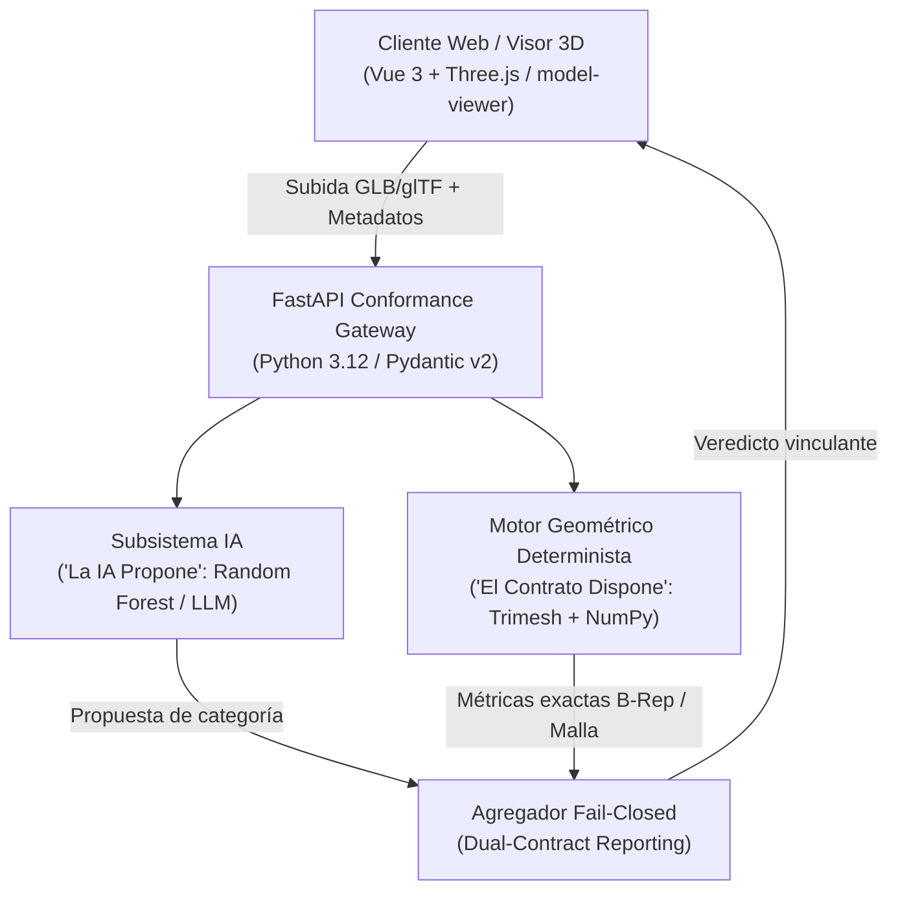

<picture>
  <source media="(prefers-color-scheme: dark)" srcset="docs/assets/banner-dark.svg">
  <source media="(prefers-color-scheme: light)" srcset="docs/assets/banner-light.svg">
  
</picture>

# Nain3D Gateway · 3D AI Conformance Engine

[](https://3d.naindev.com/)
[](https://github.com/Nain9Dev/Nain3D/actions/workflows/ci.yml)
[](https://status.naindev.com)
[](https://github.com/Nain9Dev/engineering-handbook)
[](https://github.com/Nain9Dev/engineering-handbook/blob/main/governance/zero-cost-philosophy.md)
[](https://www.python.org/)
[](https://fastapi.tiangolo.com/)
[](tests/test_architecture.py)
[](https://docs.pydantic.dev/)
[](https://vuejs.org/)
[](https://www.typescriptlang.org/)
[](LICENSE)

Motor de validación determinista de activos 3D (GLB/glTF) y pasarela de clasificación de IA, fundamentado en el principio rector:

> **"La IA propone, el contrato dispone."**  
> *(The AI proposes, the technical contract decides.)*

El subsistema de Inteligencia Artificial predice la categoría candidata y su nivel de confianza. El motor geométrico determinista evalúa el modelo contra límites matemáticos estrictos (densidad de polígonos, escala métrica, solidez hermética y micro-caras degeneradas). **Bajo ninguna circunstancia la predicción de una IA puede anular o vetar un contrato técnico fallido.**

Forma parte del portafolio técnico de [naindev.com](https://www.naindev.com) bajo la marca **Nain3D**.

---

## Qué se puede comprobar en 60 segundos

| Quiero… | Dónde |
|:---|:---|
| **Explorar el visor 3D interactivo** | Demo en vivo en [https://3d.naindev.com](https://3d.naindev.com) o local en `http://localhost:5376` (inspección 3D orbital, subida drag-and-drop y veredictos en tiempo real) |
| **Consultar la documentación OpenAPI** | [Scalar API Reference](http://localhost:8104/docs) en `/docs` |
| **Probar modelos sintéticos sin archivos** | Drawer integrado con 4 modelos de referencia (Monitor, Silla, Válvula Industrial y Silla Gigante No Conforme) |
| **Verificar la suite de pruebas** | `pytest tests/ -v` (9/9 pruebas unitarias y de integración pasando) |
| **Entender la gobernanza** | [AGENTS.md](AGENTS.md) y [docs/01-architecture.md](docs/01-architecture.md) |

---

## Arquitectura y Diagrama C4



### Matriz de Decisiones y Trade-Offs

| Dimensión | Decisión adoptada | Alternativa descartada | Razón técnica |
|---|---|---|---|
| **Gobernanza** | Puerta determinista estricta (*Fail-Closed*): la IA nunca anula el contrato | Votación por pesos o clasificación puramente probabilística | En fabricación y comercio industrial, un modelo 3D con normales invertidas o escala errónea destruye la cadena operativa aunque la IA esté al 99 % segura. |
| **Motor Geométrico** | Trimesh + NumPy en memoria en el mismo proceso | Blender headless / Subproceso CLI externo | Latencia sub-100 ms frente a más de 3 segundos de arranque de proceso en frío; menor consumo de memoria. |
| **Integridad de Entrada** | Validación binaria de cabeceras glTF/GLB e IEEE-754 antes de instanciar WebGL | Confianza en extensión de archivo o parser del navegador | Protección contra cuelgues del hilo de renderizado y denegación de servicio por buffers corruptos. |


---

## Contratos y Perfiles de Conformidad

| Perfil | Categoría | Presupuesto Triángulos | Dimensión Máxima | Hermeticidad Requerida |
|:---|:---|:---:|:---:|:---:|
| `monitor-std-01` | Monitor | 25.000 | 2.5 m | No |
| `furniture-chair-01` | Mobiliario (Chair) | 50.000 | 3.0 m | No |
| `industrial-part-01` | Pieza Industrial | 100.000 | 1.2 m | **Sí (Bloqueante)** |
| `prop-decor-01` | Prop / Decorativo | 35.000 | 4.0 m | No |

---

## Ejecución Local

### 1. Iniciar Backend (FastAPI en puerto 8104)

```powershell
.\.venv\Scripts\uvicorn src.nain3d.main:app --port 8104 --reload
```

Acceso a la documentación interactiva en: [http://localhost:8104/docs](http://localhost:8104/docs)

### 2. Iniciar Cliente (Vue 3 en puerto 5376)

```powershell
cd Nain3D.Client
npm install
npm run dev
```

Acceso a la interfaz gráfica en: [http://localhost:5376](http://localhost:5376)

### 3. Ejecutar Pruebas Automatizadas

```powershell
.\.venv\Scripts\pytest tests/ -v
npm --prefix Nain3D.Client run build
```

---

## Autor

**Aitor Nain Mendoza Vallejo (`NainDev`)**  
Full Stack Architect & 3D Software Engineer  
[naindev.com](https://www.naindev.com) · contact@naindev.com
