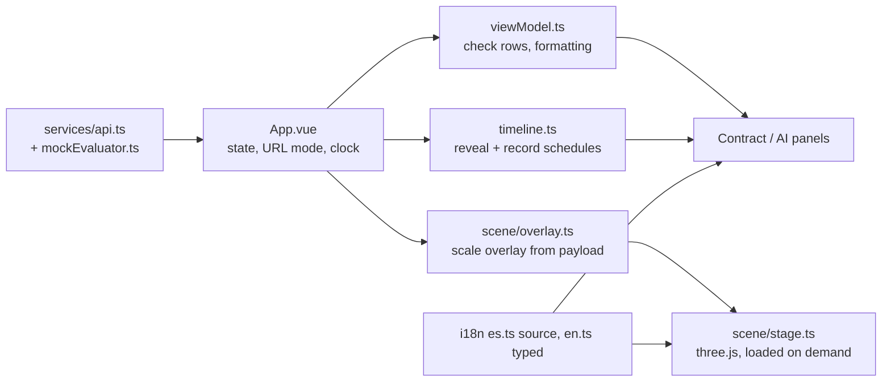

# Architecture — Nain3D Gateway

## 1. System Topology

```text
Browser Client (Vue 3 + TypeScript + three.js stage on Port 5376; ADR-002)
  │
  ├── Reverse Proxy (Vite Dev Server) -> http://localhost:8104
  │
FastAPI Host (Uvicorn on Port 8104)
  ├── Scalar OpenAPI Documentation (/docs)
  ├── Health Probes (/health, /health/ready)
  └── Conformance API (/api/v1/conformance/...)
        │
        ├── ML Classification Subsystem (RandomForest / Ollama Fallback)
        │     └── Inferred Category & Confidence Score ("La IA Propone")
        │
        └── Deterministic Conformance Engine (Trimesh & NumPy)
              ├── Feature Extraction (Triangles, Vertices, Bounding Box, Watertightness)
              ├── Mathematical Contract Evaluation (Budget, Scale, Solid Integrity)
              └── Fail-Closed Verdict Aggregator ("El Contrato Dispone")
```

## 2. Invariants

- **Boundary Separation:** File bytes are ingested in-memory and hashed via SHA-256 before any transformation.
- **Fail-Closed Logic:**
  $$\text{Verdict} = \begin{cases}
  \mathbf{NON\_CONFORMANT} & \text{if any blocking check fails} \\
  \mathbf{CONFORMANT\_WITH\_FINDINGS} & \text{if all blocking pass, but advisory fails} \\
  \mathbf{CONFORMANT} & \text{if all checks pass}
  \end{cases}$$
- **Zero Hallucination:** Even if a generative AI model claims 99% confidence that an asset is a "Chair", if the asset exceeds the 3.0 m scale bound or 50,000 polygon limit, it is rejected deterministically.

## 3. Client Presentation Layer (spec 002)

The client only presents. Every figure on screen (triangles, extents, limits, verdict, SHA-256, latency)
comes from `EvaluationResult` / `ProfileDefinition`; pass/fail flags are the API's own check results.
The client never re-decides conformance.



- **Modes:** `?mode=record` (fixed artboard 1920x1080 or 1080x1920, no chrome, deterministic clock),
  `?lang=es|en`, `?sample=<id>`, `?clock=manual`, `?format=vertical|horizontal`.
- **Languages:** Spanish (Spain) is the authoritative catalogue; English is typed against it. The choice is
  kept in `localStorage` (`nain3d.lang`), never in cookies.
- **Samples:** `Nain3D.Client/tools/generate-samples.mjs` writes the four GLBs under `public/samples/`; the API
  serves the same files when present. Static hosting (3d.naindev.com) has no API: verdicts come from the
  in-browser evaluator (`src/services/mockEvaluator.ts`), an implementation of the same four checks. Extents come
  from POSITION accessor bounds (node transforms ignored, as in the Python engine's raw geometry). Watertightness
  (every edge shared by exactly two faces, per primitive) and degenerate faces (area at most 1e-12 m2) are read from
  the triangle data by `src/services/glbMesh.ts`, and tests compare the results with the Python engine on the
  bundled samples. Geometry it cannot decode (Draco, meshopt, quantisation, strips) gives an `INCOMPLETE` verdict,
  never an approval. The AI category remains a heuristic based on file name and proportions.
