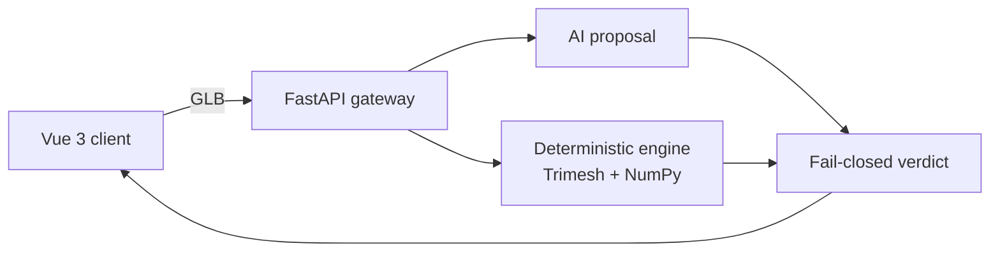

# Case study: a deterministic gate for 3D assets, with an AI that only proposes

Nain3D Gateway is a small system built to show how I approach software architecture: one hard rule at the
centre, boundaries that enforce it, and evidence for every claim. This page explains the problem, the design,
the decisions and what is still imperfect. Everything linked here is in this repository.

## The problem

Teams that publish 3D models (products, parts, furniture) get files of uneven quality. A model with the wrong
scale, a heavy triangle count or holes in the mesh breaks the pipeline after it. Asking an AI "is this a good
model?" gives a confident answer that is sometimes wrong, and a wrong approval is expensive.

## The rule

> The AI proposes, the contract decides.

The AI predicts a category and a confidence. A deterministic contract then checks four things against the
category's profile: triangle budget, physical extent, watertightness and degenerate faces. Any failing blocking
check rejects the asset, and an evaluation that cannot be completed also rejects it. The AI can never override
the contract. See [business rules](02-business-rules.md).

## Architecture

- **Backend** (`src/nain3d/`): `api/` routes and schemas, `domain/` Pydantic models and profiles, `engine/`
  geometry analysis, `ml/` the classifier. A test enforces that the domain layer imports no framework.
- **Client** (`Nain3D.Client/`): presentation only. Every number on screen comes from the API payload and the
  pass/fail flag is the API's own check result, so the client cannot disagree with the engine about conformance.
- **Static site:** the public demo has no server, so an in-browser evaluator implements the same checks. It reads
  the triangle data of the GLB and is tested against the Python engine on the bundled samples.

Details: [architecture](01-architecture.md).

## Decisions worth reading

| Decision | Why | Record |
|:---|:---|:---|
| Fail-closed aggregation | A wrong approval costs more than a wrong rejection | [AGENTS.md](../AGENTS.md), [business rules](02-business-rules.md) |
| Separate FastAPI backend and Vue client | Contract tests on the API, independent client | [ADR-001](03-decisions/ADR-001-fastapi-and-vue-showcase.md) |
| three.js stage instead of a web component | Overlays drawn from API data, deterministic clock for recordings | [ADR-002](03-decisions/ADR-002-threejs-renderer.md) |
| Sample models generated by code | Free, reproducible, closed and welded solids | [ADR-003](03-decisions/ADR-003-sample-generation.md) |
| Typed Spanish/English catalogue, no library | Missing key fails the type check, extra key fails a test | [ADR-004](03-decisions/ADR-004-client-i18n.md) |
| One licensed third-party model, pipeline and credit | Detail without copying files by hand | [ADR-007](03-decisions/ADR-007-third-party-hero-model.md) |

## Engineering details that matter

- **Determinism.** The same bytes give the same verdict in both engines. That is why the geometry is left
  uncompressed (the Python engine cannot decode Draco) and why the sample solids are welded (the engine does
  not merge vertices). The generator asserts every part is closed, outward-wound and free of degenerate faces.
- **Recording mode.** `?mode=record` drives every animation from a fixed schedule instead of wall time, so a
  capture is reproducible frame by frame and fits 9:16 and 16:9 inside platform safe zones.
- **Accessibility.** The Playwright suite runs axe against WCAG 2.2 AA in both languages and both verdicts,
  checks keyboard operation, reduced motion and language persistence without cookies.
- **Privacy.** On the public site a visitor's own `.glb` is evaluated in the browser and never sent anywhere.

## Evidence

- Python: `pytest tests/` covers the domain, the evaluator, the API, the architecture rule and the hero samples.
- Client: ESLint with accessibility rules, Vitest for the catalogue, timeline, overlay, evaluator, upload rules
  and metadata, and Playwright for captures, axe and the user flows.
- CI runs both suites on every pull request; actions are pinned to commit hashes.
- Performance, measured before and after the redesign: [metrics](visual-redesign-metrics.md).
- Every change started from a spec in [`specs/`](../specs/) with the test written first.

## What is still imperfect

- The AI category in the static demo is a heuristic on file name and proportions, not the trained classifier.
  The verdict does not depend on it for the bundled samples, but the category label can differ from the
  Python engine's.
- The Python engine is not hosted publicly (zero-cost constraint), so the live demo uses the in-browser evaluator.
- The photoreal model costs about 0.8 MB; the first screen transfers roughly 1.1 MB.
- Screenshots are stored in git; release assets would be lighter.

## Next steps I would take

1. Host the Python engine behind the same API on a free tier and let the client choose it when reachable.
2. Return face positions from the API so the client can highlight defects without computing anything itself.
3. Add a Khronos validator step as an optional blocking check.

Author: Aitor Nain Mendoza Vallejo ([NainDev](https://www.naindev.com)) · contact@naindev.com
